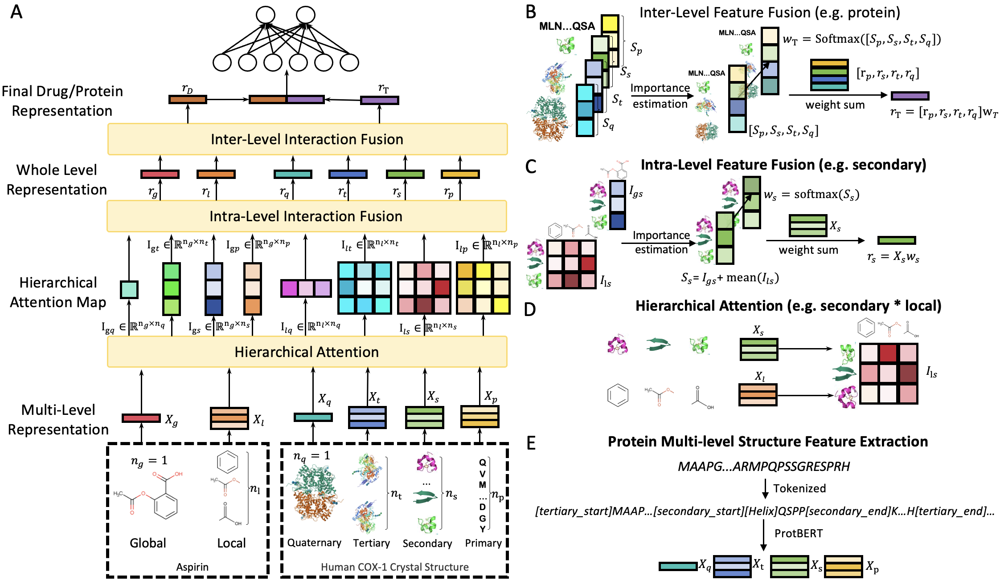

# ColdDTI: A Substructure-Aware Framework for Cold-Start Drug-Target Interaction Prediction

ColdDTI combines frozen ChemBERTa/ProtBERT features, structure-annotated protein
representations and drug–protein interaction fusion.



This repository contains the prepared DrugBank, BindingDB, BioSNAP and Human
inputs, 21 split protocols, preprocessing, main-model training, ten model variants,
prediction export and case-study visualization. Follow steps 1–5 for a first
training run, then steps 6–9 for batch experiments and analysis. Rebuilding the
supplied structure annotations is optional and described in step 10.

## Repository layout and inputs

| Path | Contents |
|---|---|
| `data/` | Source input snapshots, annotated proteins, train/validation/test CSVs and metadata |
| `preprocess/` | Structure parsing, split generation, feature extraction and artifact validation |
| `model/` | Network layers, structure pooling and checkpoint compatibility |
| `ablations/` | Shared trainer/data loader, model variants and result summaries |
| `resources/encoders.json` | Pinned encoder sources, revisions and file checksums |
| `resources/token_labels.json` | Token labels for case-study plots |
| Root Python scripts | Command-line entry points described below |

The default workflow uses the committed `protein.csv`, `smiles.csv` and split
tables. It does not require CIF downloads or a separate source-code checkout.
Encoder weights, generated NumPy features, CIFs and training outputs are kept
locally and excluded from Git. Generate the features before training a fresh clone.

## 1. Clone and install the environment

Use Linux and Python 3.10. Run the following commands in a Bash shell:

```bash
git clone https://github.com/LARS-research/ColdDTI.git
cd ColdDTI
python3.10 -m venv .venv
source .venv/bin/activate
python -m pip install --upgrade pip
```

Install one PyTorch 2.4.1 build appropriate for the machine. For CPU:

```bash
python -m pip install torch==2.4.1 --index-url https://download.pytorch.org/whl/cpu
```

For an NVIDIA GPU with a driver compatible with CUDA 12.1, use this instead:

```bash
python -m pip install torch==2.4.1 --index-url https://download.pytorch.org/whl/cu121
```

Then install the training and preprocessing dependencies:

```bash
python -m pip install -r requirements-preprocess.txt
python -m pip check
python -c "import torch; print(torch.__version__); print('CUDA available:', torch.cuda.is_available())"
```

`requirements-preprocess.txt` includes `requirements.txt`. If current feature
arrays already exist and only training/export is needed, `requirements.txt`
alone is sufficient. Plotting, clustering and raw affinity processing additionally
use `requirements-analysis.txt`, installed in step 9.

Set the device for the remaining examples and keep using the activated shell:

```bash
export COLDDTI_DEVICE=cuda:0
# For a CPU-only machine, use: export COLDDTI_DEVICE=cpu
```

Run all commands from the repository root. A GPU is recommended for full feature
generation and experiments; CPU execution is supported. Frozen encoders and the
four datasets' feature arrays require several GB of local storage. Feature
extraction processes variable-length proteins without truncation, so memory
requirements depend on sequence length as well as model size.

## 2. Check the supplied datasets and protocols

```bash
python -m preprocess.audit --data-root data
```

The command checks pair separation, held-out entities, cluster membership,
protein indices and temporal cutoffs, writes `data/split_statistics.csv` and ends
with `PASS`. The supplied release has 21 protocols and 63 partitions.

| Dataset argument | Shared protocols | Additional protocols |
|---|---|---|
| `drugbank` | `random`, `cold_drug`, `cold_protein`, `cold_pair` | `cluster`, `real_timeline` |
| `bindingdb` | `random`, `cold_drug`, `cold_protein`, `cold_pair` | `cluster_start` |
| `biosnap` | `random`, `cold_drug`, `cold_protein`, `cold_pair` | `cluster_start` |
| `human` | `random`, `cold_drug`, `cold_protein`, `cold_pair` | `cluster_start` |

The split seed is **57**. The supplied tables use these definitions:

- Duplicate pairs are removed; every row of a pair with conflicting labels is
  excluded before splitting.
- `random` divides interaction rows 80/10/10. Cold protocols divide the relevant
  entity identities 80/10/10; `cold_pair` retains pairs whose drug and protein
  belong to the same partition and discards cross-partition pairs.
- Cluster protocols use the committed `cluster_groups/` memberships. Identity
  aliases connecting clusters are merged, groups are partitioned 80/10/10, and
  only pairs with both groups in the same partition are retained.
- Splits are assigned before removing proteins with unavailable, empty or
  unparseable structures. Retained sample proportions can therefore differ
  from 80/10/10. All protocols share one `protein.csv` and its row indices.
- DrugBank `real_timeline` uses entity dates and cutoff 2010: both entity years
  must be at most 2010 for the historical pool, from which 20% becomes validation.
  A pair with either entity dated after 2010 belongs to test. Unknown dates are
  excluded. This is an entity-date protocol, not an interaction-discovery timeline.

Per-dataset `preprocessing.json`, `structure_coverage.csv` and
`split_statistics.csv` describe the inputs and retained samples.
See [data/README_data.md](data/README_data.md) for individual file definitions.
External comparison methods must use the same retained pairs and memberships;
baseline implementations are maintained separately from this repository.

## 3. Obtain and freeze the encoders

Download the base encoders using the fixed revisions and checksums in
`resources/encoders.json`:

```bash
python -m preprocess.encoders --model-root Model
python -m preprocess.encoders --model-root Model --check
```

Sources are [Rostlab/prot_bert](https://huggingface.co/Rostlab/prot_bert) and
[DeepChem/ChemBERTa-77M-MLM](https://huggingface.co/DeepChem/ChemBERTa-77M-MLM).
Only this download step requires access to the model host. Subsequent extraction
loads local files. To use existing base encoders, place their complete model and
tokenizer files in the layout below and run the `--check` command.

Create the expanded protein encoder once if `Model/prot_resize/` is absent:

```bash
python resize.py --model-root Model --seed 57
```

It adds nine tokens: `[H]`, `[E]`, `[T]`, `[B]`, `[C]`, `[secondary_start]`,
`[secondary_end]`, `[tertiary_start]`, `[tertiary_end]`, and saves the expanded
weights, tokenizer and `structure_tokens.json` with the initialization seed.
The resulting layout is:

```text
Model/
  ChemBERTa-77M-MLM/    # config, weights and tokenizer files
  prot_bert/           # base ProtBERT
  prot_resize/         # expanded ProtBERT, used for feature extraction
```

Keep the expanded encoder fixed across datasets, seeds and variants. For an
existing experiment, reuse its exact encoder and tokenizer; rerunning vocabulary
expansion is not a way to recover historical weights. The manifest also records
the reference expanded encoder's identity. **Only for an existing reference
copy**, optionally check that exact identity with the command below. Skip this
check for the encoder just created by `resize.py`:

```bash
python -m preprocess.encoders --model-root Model --models prot_resize --check
```

A newly expanded encoder has its own file identity and is recorded accordingly
when features are generated. `Model/` remains outside Git.

## 4. Generate the frozen features

Generate all four datasets using the same encoder directory:

```bash
python get_emb.py --dataset drugbank bindingdb biosnap human \
  --data-root data --model-root Model --device "$COLDDTI_DEVICE" --seed 57
```

For a first run, `--dataset human` generates only Human. Each dataset produces:

```text
data/<dataset>/
  smilestokenized.npy
  smilesembeddings.npy
  proteinstokenized.npy
  proteinsembeddings.npy
  feature_status.json
```

Encoders run frozen and in evaluation mode. Features are float32, with drug
dimension 384 and protein dimension 1024. Drugs are limited to 512 tokens;
proteins are not truncated. Extraction reads SMILES identities from `smiles.csv`
and protein row identities from `protein.csv`; sparse drug IDs are supported.

`feature_status.json` must contain `ready=true` before training. It records actual
hierarchy token IDs, encoder/tokenizer identities, input-table checksums and array
checksums. Missing metadata, changed inputs, incomplete branches and invalid
token/embedding shapes are rejected. Do not edit the ready flag manually.
If extraction is interrupted, rerun the command. To regenerate only one branch:

```bash
python get_emb.py --dataset human --data-root data --model-root Model \
  --device "$COLDDTI_DEVICE" --kind protein --seed 57
```

The dataset becomes ready only when both branches are valid. Generated arrays
stay outside Git. Reuse the same feature snapshot throughout a comparison.

## 5. Train and evaluate one full model

After generating Human features, a first full training run is:

```bash
python main.py --dataset human --split cold_pair --data-root data \
  --device "$COLDDTI_DEVICE" --seed 57 --output-dir output/main
```

`main.py` uses the shared trainer in `ablations/run.py`. Default settings:

| Parameter | Default |
|---|---|
| Optimizer | Adam |
| Learning rate | `5e-5` |
| Weight decay | `5e-4` |
| Effective batch size | `64` variable-length pairs, averaged gradients |
| Maximum epochs | `100` |
| LR decay | Multiply by `0.5` at every fifth epoch, before that epoch's training |
| Early stopping | Validation AUC, patience `5`, minimum improvement `0` |
| Interaction dimension | `704` |
| Training / boundary seed | `57` / `57` |
| Token attention layout | `batch_first=True` |

Only validation AUC selects `best.pt`. Test is evaluated once after loading that
selected checkpoint. Metrics include ROC AUC, average precision (`aupr`), F1,
precision, recall, accuracy and log loss; the classification threshold is 0.5.

Outputs for this command are:

```text
output/main/human/cold_pair/Full/seed_57/
  config.json              # parameters, preprocessing and artifact identities
  initial_validation.json  # validation metrics before optimization
  validation.csv           # epoch loss and validation metrics
  best.pt                  # validation-selected checkpoint
  metrics.json             # final test metrics and training diagnostics
  test_predictions.csv     # original test rows, score and prediction
  boundary_counts.json
```

`output/main/results.csv` collects runs and `output/main/summary.csv` gives
per-dataset/protocol/variant mean and sample standard deviation across seeds.
With one seed the standard deviation is empty. Repeating the same
dataset/protocol/variant/seed overwrites that run directory; choose a different
`--output-dir` to retain another experiment.

For a short input/output check, use a separate output directory:

```bash
python main.py --dataset human --split cold_pair --data-root data \
  --device "$COLDDTI_DEVICE" --seed 57 --train-samples 64 --epochs 1 \
  --batch-size 8 --output-dir output/short_run
```

This still requires the current feature cache. It samples training rows with
fixed seed 57 and leaves validation/test complete; it is not a benchmark result.

## 6. Run all main-model protocols with multiple seeds

The following commands define 63 runs: 21 protocols × training seeds 57/58/59.
Training seeds change model initialization and training order; they do not change
the committed data splits or boundary seed. Use these same settings consistently
when comparing experiments.

```bash
set -e
for dataset in drugbank bindingdb biosnap human; do
  python ablations/run.py --dataset "$dataset" --variant Full \
    --splits random cold_drug cold_protein cold_pair --seeds 57 58 59 \
    --data-root data --device "$COLDDTI_DEVICE" --output-dir output/main
done

python ablations/run.py --dataset drugbank --variant Full \
  --splits cluster real_timeline --seeds 57 58 59 \
  --data-root data --device "$COLDDTI_DEVICE" --output-dir output/main

for dataset in bindingdb biosnap human; do
  python ablations/run.py --dataset "$dataset" --variant Full \
    --split cluster_start --seeds 57 58 59 \
    --data-root data --device "$COLDDTI_DEVICE" --output-dir output/main
done

python ablations/summarize.py --output-dir output/main
```

The shared runner is used for both `Full` and ablations. Append `--dry-run` to
any runner command to list its jobs without loading arrays or training. Use
`--help` to inspect the supported arguments.

## 7. Run the ablations and controls

| Variant | Change |
|---|---|
| `Full` | All drug/protein branches |
| `wo_secondary` | Remove secondary-structure interactions and fusion branch |
| `wo_tertiary` | Remove configured tertiary-scope interactions and fusion branch |
| `wo_quaternary` | Remove the global protein branch |
| `wo_local` | Remove local drug interactions and fusion branch |
| `wo_global` | Remove global drug interactions and fusion branch |
| `self_attention` | Add attention inside secondary/tertiary units before pooling |
| `annotated_secondary` | Pool annotated secondary residue groups |
| `random_secondary` | Random length-matched secondary groups within scopes |
| `shuffle_secondary` | Shuffle secondary lengths and gaps within scopes |

Preview one dataset's 90-run suite:

```bash
python ablations/run.py --dataset drugbank --suite paper \
  --splits cold_drug cold_protein cold_pair --seeds 57 58 59 --dry-run
```

Run the suite for all four datasets:

```bash
set -e
for dataset in drugbank bindingdb biosnap human; do
  python ablations/run.py --dataset "$dataset" --suite paper \
    --splits cold_drug cold_protein cold_pair --seeds 57 58 59 \
    --boundary-seed 57 --data-root data --device "$COLDDTI_DEVICE" \
    --output-dir output/ablations
done
python ablations/summarize.py --output-dir output/ablations
```

This executes 360 runs, including `Full` in each suite. For a smaller group use
`--suite protein`, `drug`, `attention` or `boundary`, or select one
`--variant wo_secondary`. Outputs follow the same layout as main-model runs,
under `output/ablations/`.

`Full` pools units including boundary markers. The three boundary controls pool
residues only and should be compared with one another. Random/shuffled groups
use fixed `boundary_seed + protein_nid`, preserve unit counts and residue lengths,
and remain fixed across epochs and training seeds. They modify grouping of cached
representations; they do not re-encode sequences or remove structure tokens from
the encoder input. See [ablations/README.md](ablations/README.md) for exact rules.

## 8. Reload a checkpoint and export predictions

Export the full-model test predictions from step 5:

```bash
python export_test_predictions.py \
  --ckpt output/main/human/cold_pair/Full/seed_57/best.pt \
  --data-root data --device "$COLDDTI_DEVICE" \
  --out_csv output/predictions/human_cold_pair.csv \
  --out_pos_csv output/predictions/human_cold_pair_positive.csv
```

The exporter reads the run's dataset, protocol, variant and dimensions from the
adjacent `config.json`; no manual model reconstruction is needed. It preserves
test rows, adds `score`/`prediction` and their `y_score`/`y_pred` aliases, plus
`y_true` and the protein identity used by the model. The positive file contains
predicted class-1 rows; an empty file with headers is valid if no row is positive.
For DrugBank, add `--drugbank_map_csv data/drugbank/drug_identifiers.csv` to append
the corresponding DrugBank identity.

Keep `best.pt` with its matching `config.json`. The checkpoint contains
`state_dict` and an embedded `artifact_contract` binding the implementation,
attention layout, parameters, run ID, feature identity and train/validation/test
checksums. Training reload, export and case study all enforce this contract.
To move a run, copy the checkpoint/config, input tables, splits, four feature
arrays and feature metadata together, then pass the relocated `--data-root`.

Compatible legacy weights can be registered without retraining only if their
original configuration records `batch_first=True`, settings match the current
cache, and original test predictions replay within absolute tolerance `1e-6`:

```bash
python -m model.checkpoint --register-legacy /path/to/old_run/best.pt \
  --reference-predictions /path/to/old_run/test_predictions.csv \
  --data-root data --output-dir output/registered_run --device cpu
```

The new directory must be empty or absent. Registration preserves the original
run; unknown or incompatible attention layouts are rejected.

## 9. Export case studies and coverage statistics

Install the optional analysis dependencies:

```bash
python -m pip install -r requirements-analysis.txt
```

To visualize the most confident Human predictions from step 8:

```bash
python case_study.py \
  --ckpt output/main/human/cold_pair/Full/seed_57/best.pt \
  --data-root data --device "$COLDDTI_DEVICE" \
  --predictions output/predictions/human_cold_pair.csv --top-k 5 \
  --output-dir output/case_study/human
```

For the supplied DrugBank Propiverine–CHRM4 example, use a temporal checkpoint
from step 6:

```bash
python case_study.py \
  --ckpt output/main/drugbank/real_timeline/Full/seed_57/best.pt \
  --data-root data --device "$COLDDTI_DEVICE" \
  --drugbank-id DB12278 --protein-id P08173 \
  --output-dir output/case_study/drugbank
```

Other exact selections can use `--drug-nid` and `--protein-id`; selected pairs
must belong to that checkpoint's test partition. Outputs include
`selected_cases.csv` and a `<smiles_nid>_<protein_id>/` directory containing
`case.json`, `interaction_maps.npz`, PNG/PDF heatmaps, `protein_tokens.csv`,
`protein_units.csv` and `reference_regions.csv`. Add `--no-plots` for numeric
exports only. Source-sequence alignment determines residue positions; supplied
transmembrane annotations include reference-sequence checksums. The plots show
model compatibility/pooling scores, not measured physical contacts.

Summarize retained/excluded structures by length, interaction count and label
ratio:

```bash
python -m preprocess.coverage --data-root data \
  --output-dir output/structure_coverage
```

Outputs are `protein_selection.csv` and `retained_excluded_summary.csv`.

## 10. Rebuild structure annotations and splits (optional)

Skip this step to reproduce runs on the committed input snapshot. To rebuild,
place structures at `CIF_ROOT/<dataset>/cif/<protein_id>.cif`, for example:

```text
/path/to/CIF_ROOT/
  drugbank/cif/
  bindingdb/cif/
  biosnap/cif/
  human/cif/
```

Alternatively, download candidate CIFs into the local dataset directories:

```bash
set -e
for dataset in drugbank bindingdb biosnap human; do
  python download.py --dataset "$dataset" --data-root data
done
```

The downloader tries configured AlphaFold model versions; a downloaded file must
still pass structure parsing. Current online structures can differ from the
supplied snapshot. With an external CIF root, run:

```bash
python filter.py --dataset all --data-root data --cif-root /path/to/CIF_ROOT \
  --tertiary-mode chain --seed 57 --workers 4
python -m preprocess.audit --data-root data
```

Omit `--cif-root` if downloads are in `data/<dataset>/cif/`. Preparation uses the
committed `observations.csv`, `source_proteins.csv`, `smiles.csv`, cluster
memberships and DrugBank entity-date tables. It refreshes all protocols and
protein indices together and marks features stale. **Repeat step 4 before
training on rebuilt data.**

Secondary annotations come from `struct_conf` and `struct_sheet_range`, aligned
with `label_asym_id`/`label_seq_id` to recovered amino-acid residues. Overlaps use
priority H > E > T > B > C. The tertiary scope modes are:

| `--tertiary-mode` | Scope |
|---|---|
| `chain` (default) | One range per recovered chain |
| `domain` | Actual `pdbx_domain_range` or explicit domain ranges; requires valid annotations |
| `auto` | Use domain ranges where available, otherwise chain ranges |
| `none` | No tertiary markers; the existing model branch falls back to global mean pooling |

Supply explicit ranges using `--tertiary-ranges domains.csv` with
`protein_id,chain_id,start,end`; chain IDs are label chain IDs and endpoints use
one-based inclusive label residue numbering. `--chains A B` and `--model-index 0`
select chains/models. Secondary units crossing tertiary boundaries are split.
The model's p/s/t/q names mean token/secondary/configured scope/global mean;
default chain and global scopes do not encode full tertiary/quaternary geometry.
To remove the tertiary model branch, use `wo_tertiary` rather than mode `none`.

Preparation stages and audits tables before publication. If publication is
interrupted, restore the previous tables with:

```bash
python filter.py --dataset drugbank --data-root data --recover
```

A normal subsequent preparation run also recovers before rebuilding. CIFs and
large feature arrays are not copied into publication backups.

## 11. Additional input preparation (optional)

These tools write separate outputs and are not required for steps 1–9.

To generate alternative cluster memberships and compare them to supplied groups:

```bash
python -m preprocess.cluster --dataset human --data-root data \
  --drug-distance 0.5 --protein-distance 0.85 \
  --compare-groups data/human/cluster_groups --output-dir output/clustering/human
```

The algorithm uses single linkage; drug features are ECFP4 (radius 2, 2048 bits)
with Jaccard/Tanimoto distance, and protein features are character 3-mer TF-IDF
with cosine distance. Outputs include memberships, split tables and
`clustering.json` with settings/comparison statistics. These are new cluster
inputs; use the committed memberships to reproduce the supplied cluster
protocols. Protein cosine distance is not a sequence-identity threshold.

To map an existing labeled BindingDB benchmark by exact stripped sequence and
SMILES, provide `SMILES,Protein,Y` columns and a new/empty output directory:

```bash
python -m preprocess.bindingdb map --input-csv /path/to/bindingDB.csv \
  --protein-csv data/bindingdb/source_proteins.csv \
  --smiles-csv data/bindingdb/smiles.csv --output-dir output/bindingdb_mapping
```

Outputs are `bindingDB_mapped.csv`, `unmapped.csv` and `mapping.json`.
Independent raw affinity processing is also available:

```bash
python -m preprocess.bindingdb raw --input-tsv /path/to/BindingDB.tsv \
  --positive-p 6 --negative-p 5 --censored-policy exclude \
  --output-dir output/bindingdb_raw
```

The TSV must contain `Ligand SMILES`,
`UniProt (SwissProt) Primary ID of Target Chain 1`,
`BindingDB Target Chain Sequence 1`, and `Ki (nM)`, `Kd (nM)`, `IC50 (nM)`,
`EC50 (nM)`. Processing uses that affinity priority, canonicalizes SMILES and
computes p-affinity as `-log10(nM × 1e-9)`: values at least 6 are positive,
at most 5 negative, and intermediate values excluded. Qualified measurements
are excluded by default; `legacy_numeric` selects numeric-extraction behavior.
Outputs include `fulldata.csv`, entity tables and `raw_preprocessing.json`.
These operations do not overwrite the committed benchmark inputs.

## Troubleshooting and reproducibility

| Symptom | Action |
|---|---|
| Missing/stale feature metadata | Complete step 4 for that dataset; keep both branch arrays with their metadata |
| Input-table or array checksum mismatch | Restore the matching snapshot, or regenerate features and train a new run |
| Checkpoint/config/data mismatch | Use the matching `config.json`, splits and feature snapshot; pass relocated `--data-root` explicitly |
| Interrupted preprocessing publication | Run `filter.py --dataset <dataset> --data-root data --recover` |
| CUDA unavailable | Install a compatible PyTorch build or set `COLDDTI_DEVICE=cpu` |
| Memory exhausted | Use a device with enough memory for the longest sequence; extraction and downstream forwards handle one variable-length pair/sequence at a time |

Use the same encoder/tokenizer, prepared tables, feature snapshot and experiment
configuration across methods and seeds. CUDA/hardware/library differences can
affect numerical results. Full experimental metrics are generated by the runs
above; short checks are not substitutes for complete multi-seed evaluation.

## Citation

Please cite the ColdDTI paper when using this code.
